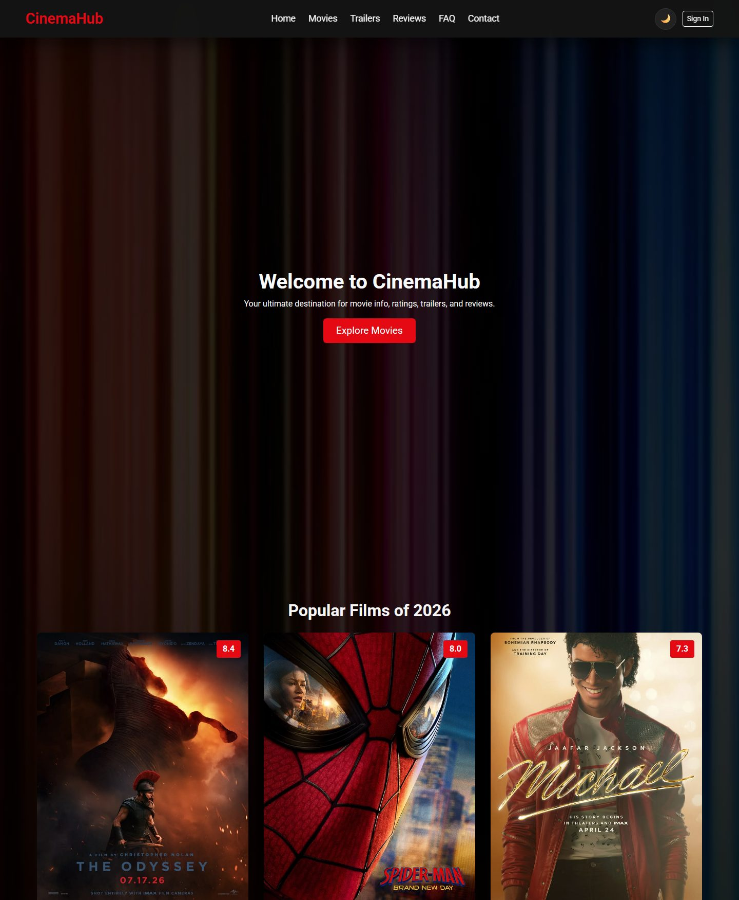

# CinemaHub



A movie website we made for our Web Development course. It started as the midterm project and for the
endterm we turned it into something you can actually play with: switch the theme, sign in, read the FAQ
and search real titles from the TVMaze API without leaving the page.

**Site:** https://zhalayminbaev2003-hub.github.io/WebMidterm/
**Code:** https://github.com/zhalayminbaev2003-hub/WebMidterm
**Report with screenshots:** [report/REPORT.md](report/REPORT.md)

---

## The three of us

- **Turganbay Islambek**
- **Almanzor Kamzeyev**
- **Nurkhan Karashev**

---

## What's inside

Six pages, one shared navigation bar, one stylesheet, one script file.

**Home** — the big banner, three popular films of the year, the TV schedule for the day you pick and the
poster gallery. Click a poster and it opens in a lightbox, with the arrows to move to the next one. Once
you sign in, the "Your account" block turns into a greeting with your name.

**Movies** — six films we picked by hand, a search box that filters as you type and genre buttons
(Sci-Fi, Action, Drama). Under that sits the live search: type any title and it asks TVMaze and shows
what it finds — poster, rating, genres and a link to the show. You can sort the results by name, rating
or year, or ask for a completely random one.

**Trailers** — two trailers in a 16:9 player that keeps its shape on every screen.

**Reviews** — the ranking table with the films we think are worth watching. If you sign in you can add
your own row, fix a typo in one of them or delete it. It all stays in the browser, so your list is still
there after you close the tab.

**FAQ** — nine questions, and each answer folds open with a slide instead of appearing out of nowhere.

**Contact** — the feedback form: name, e-mail, password with a strength bar, a genre dropdown and a
message. It refuses to send anything until the fields make sense.

---

## The bits we are most proud of

**The themes.** One round button in the header switches between dark and light. We moved every colour
into CSS custom properties, so the light theme is basically a second set of variables — no duplicated
rules and no second stylesheet. The chosen theme is stored in `localStorage` and applied before the
first paint, so the page never flashes the wrong colours.

**The sign-in.** A small window with a name, an e-mail and a password. The e-mail is checked with a
regular expression, the password needs at least six characters, and the form tells you what is wrong
while you are still typing. Only the name, the e-mail and the time of the login get saved — we did not
want a password sitting in the browser. The session survives a refresh, the header shows your name
instead of the Sign In button, and the rating form on the Reviews page opens up. Sign out wipes it.

**The FAQ accordion.** jQuery `.slideToggle()`, with a `+` / `−` sign that follows the state of every
question, and *Expand all* / *Collapse all* buttons.

**The API.** We use the free [TVMaze API](https://www.tvmaze.com/api). It needs no key and it allows
requests straight from the browser — that is exactly why we picked it, the same code keeps working on
the published site. We call `fetch()`, read the JSON and draw the cards with jQuery. Every request has
a 12 second timeout, and if the service is slow or down the page says so instead of leaving an empty
box.

---

## Things we know are not perfect

- The sign-in is a demo. There is no server behind it, so any valid e-mail and a six character password
  will do.
- The random title button takes a random page of the TVMaze list, so you may end up with a documentary
  instead of a blockbuster.
- A couple of the posters are the low resolution versions we found on Wikipedia.
- The trailer players are YouTube embeds, so they need an internet connection.

---

## How we built it

HTML5, CSS3 (Flexbox, Grid, custom properties), Bootstrap 5.3, JavaScript with jQuery 3.7.1, the TVMaze
API, Git and GitHub Pages. jQuery, Bootstrap and every image sit inside the project folder, so the site
does not depend on somebody else's link staying alive.

---

## Who did what

**Turganbay** set the project up and built the Home page and the catalog layout. For the endterm he
wrote the theme manager and the API layer, and put the two API blocks on the site — the title search on
Movies and the TV schedule on Home.

**Almanzor** made the Trailers page, wrote the main stylesheet and made everything work on a phone. For
the endterm he moved the colours into custom properties, built the light theme on top of them, styled
everything new that showed up on the site and created the FAQ page with the accordion.

**Nurkhan** built the Reviews and Contact pages, the form validation and the password strength bar, and
kept the Git history in order. For the endterm he wrote the sign-in and sign-out logic, the part that
shows a different interface to a signed-in user and to a guest, and he put this README and the report
together.

---

## Running it locally

```bash
python -m http.server 8000
```

then open http://localhost:8000. Opening `index.html` straight from the folder works too — only the API
blocks need the internet.

```
WebMidterm/
├── index.html          Home
├── movies.html         Catalog + live API search
├── trailers.html       YouTube trailers
├── reviews.html        Ranking table with add / edit / delete
├── faq.html            The accordion
├── contact.html        Feedback form
├── README.md
├── report/REPORT.md    Endterm report with screenshots
├── css/style.css       All styles, both themes
├── js/
│   ├── jquery.min.js   jQuery 3.7.1
│   ├── theme.js        Remembers the theme
│   ├── api.js          Everything that talks to TVMaze
│   └── script.js       Forms, gallery, search, CRUD, sign-in, FAQ
├── images/             Posters and the background
└── vendor/bootstrap/   Bootstrap 5.3
```
