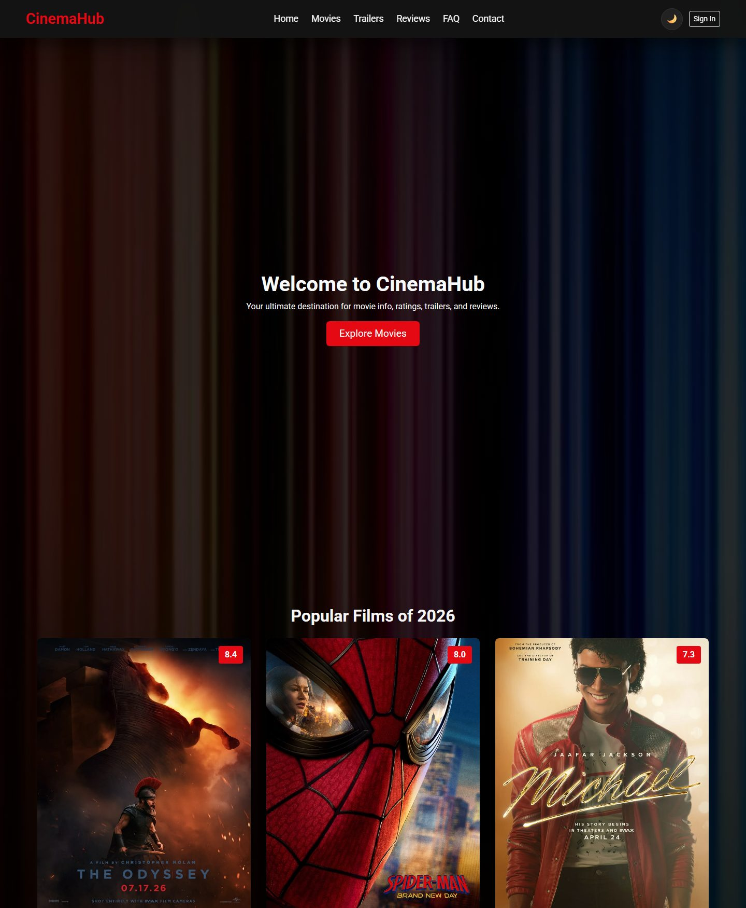
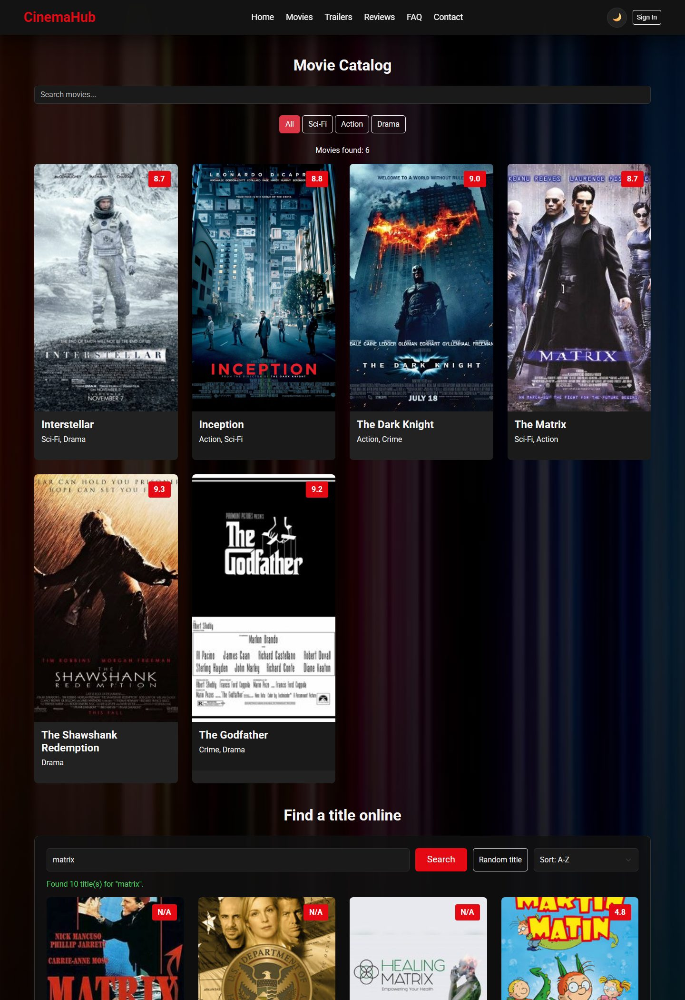
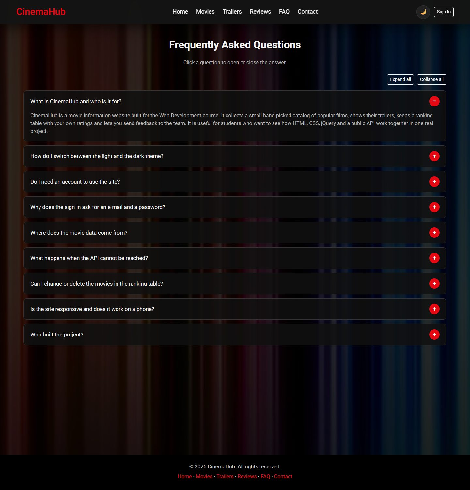
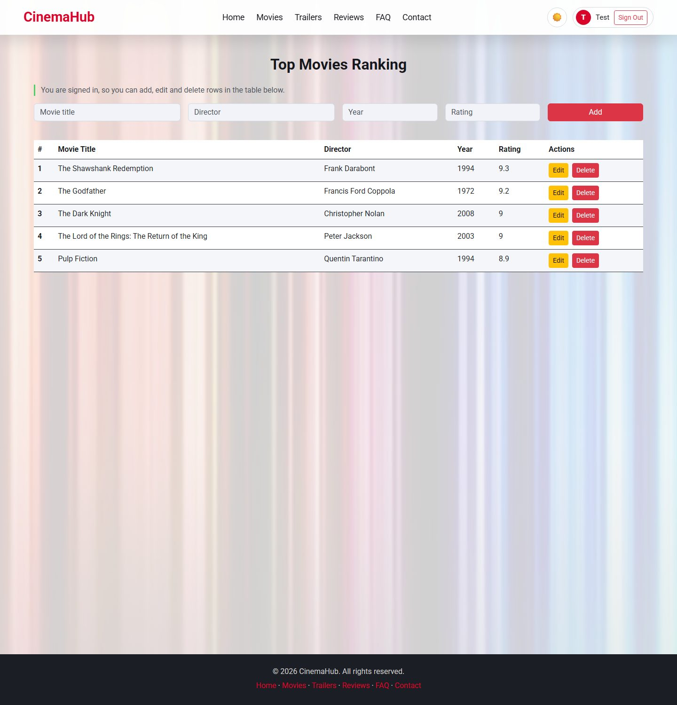
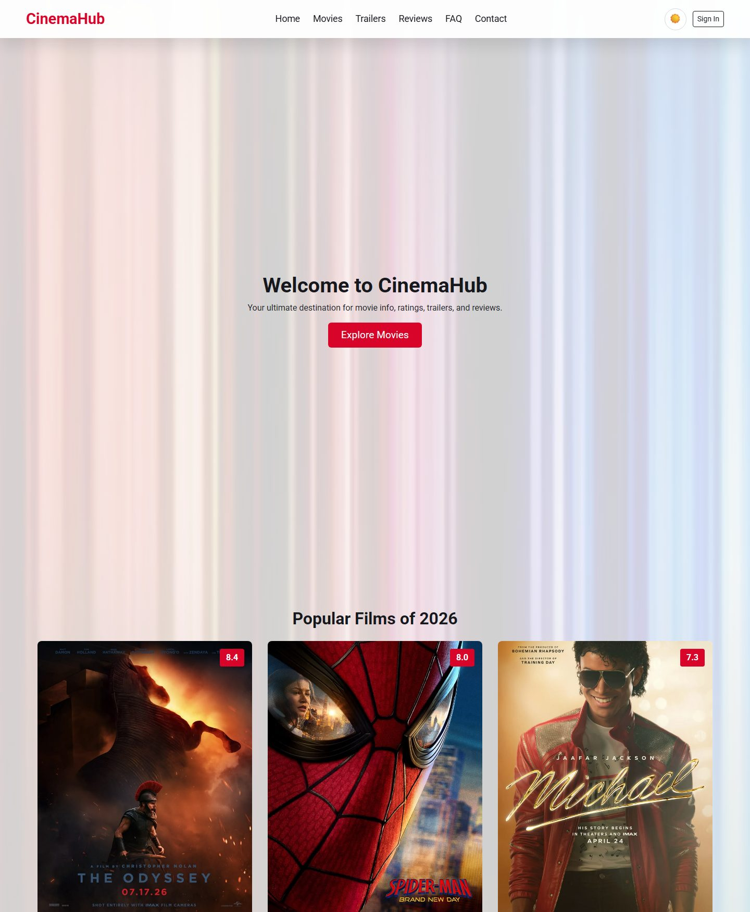
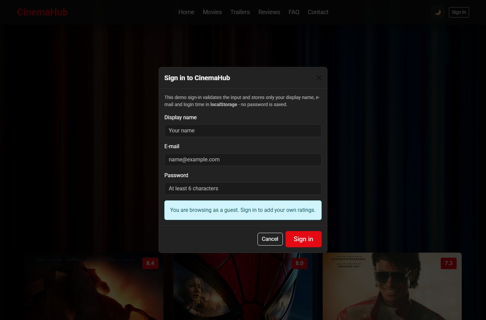

# CinemaHub — Endterm Project Report

**Course:** Web Development
**Institution:** Astana IT University
**Year:** 2026
**Project topic:** CinemaHub — a movie information website
**Group members:** Turganbay Islambek, Almanzor Kamzeyev, Nurkhan Karashev

**Live website:** https://zhalayminbaev2003-hub.github.io/WebMidterm/
**GitHub repository:** https://github.com/zhalayminbaev2003-hub/WebMidterm

---

## 1. Project Objectives

The endterm project had to be the continuation of the midterm project: the same topic, the same group
and the same repository, extended with the features listed in the *Final Project Requirements*.

Our goals for the endterm stage:

1. Extend the existing CinemaHub website without breaking the midterm features.
2. Implement a **light / dark theme** that is remembered between visits.
3. Implement a **sign-in** with `localStorage` that keeps the user signed in and changes the interface
   for signed-in users.
4. Build a **FAQ section** with a jQuery accordion based on `.slideToggle()`.
5. Integrate a **real public API** with `fetch()`, JSON processing, dynamic rendering and error handling.
6. Keep the site **responsive** and visually consistent, and publish it on GitHub Pages.

---

## 2. Website Structure

The website consists of **6 pages** connected by one shared navigation bar that is visible on every
page and always shows the active page.

| Page | File | Purpose |
|------|------|---------|
| Home | `index.html` | Hero banner, popular films, account panel, live TV schedule, poster gallery with lightbox |
| Movies | `movies.html` | Catalog with live search and genre filters, plus the TVMaze API search block |
| Trailers | `trailers.html` | Official trailers embedded with YouTube `iframe` elements |
| Reviews | `reviews.html` | Ranking table with Add / Edit / Delete operations (CRUD) stored in `localStorage` |
| FAQ | `faq.html` | 9 questions with a jQuery `.slideToggle()` accordion |
| Contact | `contact.html` | Feedback form with validation, password strength indicator and session panel |

```
index.html  ──►  movies.html  ──►  trailers.html  ──►  reviews.html  ──►  faq.html  ──►  contact.html
     ▲                │                  │                 │                 │                 │
     └────────────────┴──────────────────┴─────────────────┴─────────────────┴─────────────────┘
                                   shared header & navigation
```

File structure:

```
WebMidterm/
├── index.html, movies.html, trailers.html, reviews.html, faq.html, contact.html
├── README.md, report/REPORT.md
├── css/style.css
├── js/jquery.min.js, js/theme.js, js/api.js, js/script.js
├── images/ (posters + background)
└── vendor/bootstrap/ (bootstrap.min.css, bootstrap.bundle.min.js)
```

---

## 3. Implemented Features

### 3.1 HTML & CSS (10 points)

- Valid HTML5 with semantic elements: `header`, `nav`, `main`, `section`, `article`, `footer`, `label`,
  `table` with `scope` attributes, `aria-label` / `aria-current` for accessibility.
- **One external stylesheet** (`css/style.css`) for the whole project.
- A consistent design system built on **CSS custom properties** (colours, radius, shadows, overlay),
  which is what makes the light/dark themes possible.
- **Flexbox** for the header, the account panel and the FAQ toolbar; **CSS Grid** for the movie cards,
  the API results and the schedule list.
- Responsive breakpoints at 992px, 768px, 600px and 480px: the navigation bar wraps into rows on
  tablets and switches to a vertical column on phones, movie cards become a single column, the trailer
  players keep their 16:9 ratio.
- All images, jQuery and Bootstrap are stored **inside the project folder** (`images/`, `js/`,
  `vendor/`), so the site does not depend on third-party hotlinks.

### 3.2 JavaScript (20 points)

**Light / dark theme toggle** (`js/theme.js`, `js/script.js`)

- The button in the navigation bar switches the theme with `CinemaHub.theme.toggle()`.
- The theme is applied through the `data-theme` attribute on `<html>`; every colour in the stylesheet
  is a variable, so the whole site changes at once.
- The selected theme is written to `localStorage` under the key `cinemahubTheme` and read back on every
  page load — the theme stays active after a refresh and is identical on all 6 pages.
- `js/theme.js` is loaded synchronously in `<head>`, so the stored theme is applied **before the first
  paint** and the page never flashes the wrong colours.

**Sign-in with localStorage** (`js/script.js`)

- A Bootstrap modal contains the sign-in form with three fields: display name, e-mail and password.
- Input validation: the e-mail is checked with the RegExp `/^[^\s@]+@[^\s@]+\.[^\s@]+$/`, the password
  must be at least 6 characters, the name is optional and is derived from the e-mail when it is empty.
  Every field shows its own error message and the `is-invalid` / `is-valid` state.
- On success, only **non-sensitive** data is stored in `localStorage` under `cinemahubUser`
  (`name`, `email`, `signedInAt`) — the password is never stored.
- The session survives a refresh: on every page load `renderUser()` reads `localStorage` and updates
  the interface.
- Signed-in interface: the *Sign In* button is replaced by a user chip with the initial letter, the
  name and a *Sign Out* button; the Home page shows a personalised "Welcome back" card; the Reviews
  page unlocks the Add / Edit / Delete form (it is disabled for guests).
- *Sign Out* removes the saved session from `localStorage` and returns the guest interface.

### 3.3 jQuery (10 points)

- The FAQ page contains **9 questions** about the project, the theme, the sign-in, the API, the
  responsive design and the team.
- Every answer is opened and closed with jQuery **`.slideToggle()`** and a 350 ms animation.
- The `+` / `−` indicator on the right of each question shows whether the answer is expanded, and the
  `aria-expanded` attribute is updated for accessibility.
- *Expand all* and *Collapse all* buttons are implemented with `.slideDown()` / `.slideUp()`.
- The midterm jQuery features (validation, lightbox, live search, filters, CRUD) were kept and
  refactored into the same file.

### 3.4 API integration (15 points)

**TVMaze API** — <https://www.tvmaze.com/api>, a free public API for movies and series that needs no
API key and allows cross-origin requests, which is why it also works on the deployed GitHub Pages site.

| Endpoint | Where it is used | Interaction |
|----------|------------------|-------------|
| `GET /search/shows?q=` | Movies page | Text search with live results |
| `GET /shows/random` | Movies page | "Random title" button |
| `GET /schedule?country=US&date=` | Home page | Date picker + schedule list |

- All requests use `fetch()` and are wrapped in a small API layer (`js/api.js`) that returns parsed
  **JSON**, normalises the data and converts the HTML description into plain text.
- The data is rendered dynamically with jQuery: poster, rating badge, title, genres, year, summary,
  genre tags and a link to the title page.
- User interaction: search, sorting of the loaded results (A–Z, highest rating, newest first), a random
  pick and a date picker for the schedule.
- **Error handling**: the response status is checked (`response.ok`), every request has a 12-second
  timeout via `AbortController`, and `try / catch` converts network failures, timeouts and empty
  answers into a clear message in the status line instead of an empty page. A retry is one click away.

### 3.5 Report and documentation

- `README.md` — topic, group members, implemented features, technologies, contribution of every member,
  folder structure and run instructions.
- `report/REPORT.md` — this document: objectives, structure, features, development process, contributions,
  screenshots and links.

---

## 4. Development Process

1. **Analysis.** We compared the midterm website with the list of the endterm requirements and listed
   the missing parts: theme toggle, sign-in, FAQ accordion, API integration, README/report.
2. **Refactoring of the stylesheet.** The colours of the midterm stylesheet were converted into CSS
   variables, which made the second theme possible without duplicating the rules.
3. **Implementation.** Every feature was developed in its own file (`js/theme.js`, `js/api.js`,
   `js/script.js`) and connected to the shared navigation bar, so all pages behave identically.
4. **Local assets.** jQuery, Bootstrap and all the images were downloaded into the project folder so
   the submission is complete and works without a network connection (except the API block).
5. **Testing.** Every page was checked in the browser: theme persistence after a refresh, sign-in and
   sign-out, the FAQ animation, the API answers and the error states, and the layout at desktop, tablet
   and mobile widths.
6. **Documentation and publishing.** README and report were updated, the work was committed with clear
   messages and the site was published with GitHub Pages.

Git workflow: one shared repository, separate commits per feature so that the history shows the work
of every team member.

---

## 5. Individual Contributions

### Turganbay Islambek
- Project setup, global HTML structure, Home page and movie catalog layout (midterm).
- **Light / dark theme toggle**: `js/theme.js` (theme storage and pre-paint application) and the
  button handling in `js/script.js`.
- **API layer** `js/api.js`: `fetch()` wrapper, timeout, JSON normalisation, TVMaze endpoints.
- "Find a title online" block on the Movies page and the "On TV today" widget on the Home page.
- Integration of the shared navigation bar, the sign-in modal and the footer on all 6 pages.

### Almanzor Kamzeyev
- Trailers page, global styling, Flexbox / CSS Grid layout and responsive design (midterm).
- **FAQ page** with the jQuery `.slideToggle()` accordion, the `+` / `−` indicators and the
  *Expand all* / *Collapse all* buttons.
- Refactoring of `css/style.css` into design tokens and creation of the **light theme**.
- Styling of all new components: theme button, user chip, sign-in modal, API panels, schedule list,
  FAQ accordion.

### Nurkhan Karashev
- Reviews page, Contact page, form validation and password strength indicator (midterm).
- **Sign-in / sign-out logic**: validation, `localStorage` session, `renderUser()`, the signed-in and
  guest interfaces (user chip, account card, locked rating form on the Reviews page).
- Update of `README.md` and the report.

---

## 6. Screenshots

| Home page | Movies page (API search) |
|---|---|
|  |  |

| FAQ page | Reviews page (signed in) |
|---|---|
|  |  |

| Light theme | Sign-in modal |
|---|---|
|  |  |

---

## 7. Links

- **Published website:** https://zhalayminbaev2003-hub.github.io/WebMidterm/
- **Repository:** https://github.com/zhalayminbaev2003-hub/WebMidterm
- **API used:** https://www.tvmaze.com/api
- **Live demo of the API:** https://api.tvmaze.com/search/shows?q=matrix
